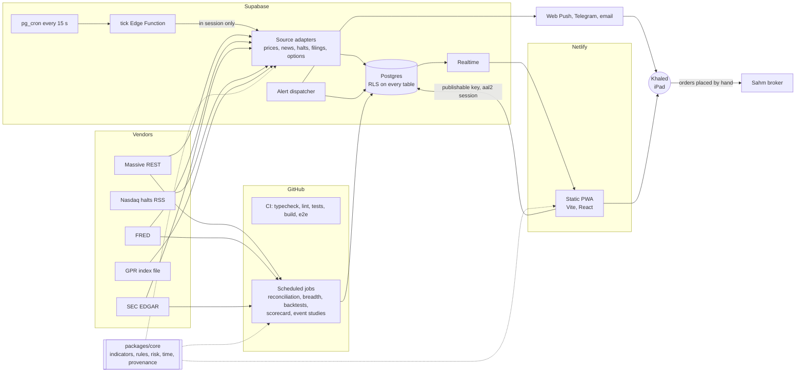

# Marsad architecture

Marsad is a static web app backed by Supabase, with heavy batch work in GitHub Actions. One pure TypeScript engine (`packages/core`) computes every indicator, rule and risk figure, and runs unchanged in the browser, in Supabase Edge Functions (Deno) and in Node jobs. Decisions are recorded in [adr/](adr/).

## Components

| Part                  | Runs on                 | Role                                                                                                   |
| --------------------- | ----------------------- | ------------------------------------------------------------------------------------------------------ |
| `apps/web`            | Netlify (static)        | Authenticated PWA. Reads data under row-level security with the publishable key.                       |
| `packages/core`       | Browser, Deno, Node     | Pure functions: time, indicators, rules, risk, formatting, provenance types, prompts. No runtime APIs. |
| `supabase/migrations` | Supabase Postgres       | Schema, RLS policies, retention jobs. Tested offline with PGlite.                                      |
| `supabase/functions`  | Supabase Edge Functions | `tick` fan-out, adapters, alert dispatcher (Phases 1 and 5).                                           |
| `jobs`                | GitHub Actions          | Batch analytics on schedules (Phase 1 onward).                                                         |
| `fixtures`            | Tests                   | Recorded vendor responses, keys stripped.                                                              |

## Security model

- Supabase Auth with email one-time codes (sign-ups disabled) and mandatory TOTP. The app routes any session below AAL2 to the MFA screen.
- Every RLS policy also requires an AAL2 token, so an email code alone reads nothing.
- Personal tables are keyed by `owner_id = auth.uid()`. System tables (job runs, source status, market data) are written only with the secret key and readable only by users in `private.app_owners`.
- The browser holds only the publishable key. Netlify serves a strict CSP (the only inline allowance is one hash-pinned style, see ADR 0002), `X-Robots-Tag: noindex` and a deny-all `robots.txt`.

## Data flow and freshness

Adapters write values with provenance (source, endpoint, as-of time, plan tier). Each job writes a `job_runs` row; each source updates `source_status`. The status page shows both. A feed that goes stale in session pauses dependent rules and raises a system alert (Phase 1 and 5).

## Limits that shape the design

Checked 2026-11-23 from the brief's platform facts; re-check the vendor docs before relying on a limit.

- Edge Functions: 150 s wall clock on Free, about 2 s CPU per request, so each invocation fetches little and computes incrementally.
- pg_cron: second-level schedules cannot combine with other fields, so session gating happens inside `tick`.
- No always-on WebSocket in serverless, so version 1 polls every 10 to 30 seconds.
- Supabase Free pauses after a week of low activity; Pro is required before live alerts.
